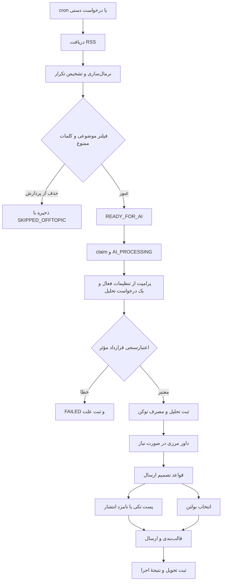

# سند توسعهٔ محصول و گردش‌کار عامل هوشمند اخبار

آخرین بازبینی: ۲۰۲۶-۱۰-۲۸ · وضعیت: توصیف نسخهٔ موجود و برنامهٔ پیشنهادی توسعه

> این سند راهنمای محصول، توسعه و بهره‌برداری است؛ اثبات سلامت محیط عملیاتی یا تعهد به ارسال تضمینی نیست. بخش‌های «موجود» از «پیشنهادی» جدا شده‌اند. برای جزئیات اجرایی، کد و سند تخصصی همان بخش مرجع‌اند.

## ۱. هدف محصول

تبدیل جریان خبر به تعداد محدودی خبر قابل‌اعتماد و قابل‌اقدام برای مخاطبان اعتبارسنجی و رتبه‌بندی اعتباری، با مصرف کنترل‌شدهٔ AI و قابلیت توضیح تصمیم‌ها.

### مخاطب و مسئله

- **مسئول محتوا:** انتخاب و انتشار خبر مرتبط، بدون مرور دستی همهٔ منابع.
- **تحلیلگر اعتباری:** دریافت تغییرات مؤثر بر ارزیابی اعتباری و توان بازپرداخت.
- **مدیر سامانه:** کنترل منابع، قواعد تحلیل، قالب‌ها و زمان‌بندی از داشبورد.
- **توسعه‌دهنده/بهره‌بردار:** تشخیص خطا، آزمون و انتشار تغییرات بدون از دست رفتن داده و تنظیمات.

### تعریف ارتباط مطلوب

| دسته | تعریف | نمونه |
|---|---|---|
| مستقیم | موضوع اصلی، اعتبارسنجی یا رتبه و ریسک اعتباری است | تغییر روش امتیازدهی یا مقررات مؤسسهٔ اعتبارسنجی |
| اثر مشخص | متن خبر شاهدی از اثر بر بازپرداخت، نکول، وثیقه، ضمانت یا تصمیم اعتباری دارد | افزایش معوقات یا تغییر مقررات تضمین وام |
| ارتباط حدسی | پیوند صرفاً با استدلال بیرونی قابل تصور است | خبر عمومی تورم بدون اثر اعتباری مشخص در متن |
| نامرتبط | ارتباطی با حوزه ندارد | بودجهٔ جاده یا شارژ کالابرگ بدون پیوند اعتباری |

معیار مطلوب محصول، پذیرش دو دستهٔ اول است؛ پیاده‌سازی فعلی هنوز محدودیت‌های کلمه‌ای و قواعد ثابت دارد و لزوماً همهٔ مصادیق این تعریف را درست تشخیص نمی‌دهد.

### اصول غیرقابل‌چشم‌پوشی

1. اهمیت بالا، ارتباط پایین را جبران نکند.
2. برای پر کردن بولتن پنج‌خبری، خبر نامرتبط یا قدیمی اضافه نشود.
3. فیلترشدن به معنی حذف فیزیکی خبر نباشد؛ امکان بررسی مجدد حفظ شود.
4. ذخیرهٔ پیش‌نویس با فعال‌سازی تنظیمات یکی نباشد.
5. پیش‌نمایش و ارسال واقعی تا حد امکان از منطق مشترک استفاده کنند.
6. کلیدها، توکن‌های دسترسی و رشتهٔ اتصال در Git یا لاگ عمومی قرار نگیرند.

## ۲. دامنه و وضعیت قابلیت‌ها

### موجود در کد

- دریافت RSS، نرمال‌سازی، تشخیص تکرار و ثبت وضعیت منابع.
- فیلتر کلمه‌ای قبل از AI؛ موضوعات و فهرست‌های ممنوع قابل تنظیم.
- تحلیل ساختاریافته، امتیازهای اهمیت/ارتباط/تازگی و هشتگ مستقل.
- پیکربندی نسخه‌دار، پیش‌نویس، فعال‌سازی و تست تنظیمات.
- داور دوم برای امتیازهای مرزی با بازه و کلید فعال‌سازی قابل تنظیم.
- ارزیابی آزمایشی مستقل با شاهد ارتباط، اهمیت وزن‌دار و سن خبر.
- قالب مستقل پست، قالب کل بولتن و قالب هر خبر داخل بولتن.
- ارسال local و بله، نامزد انتشار و تاریخچهٔ تحویل.
- زمان‌بندی، heartbeat، نتیجهٔ اجرا و جست‌وجوی شکاف پوشش در صورت فعال بودن.
- ثبت مصرف توکن تحلیل و نمایش آمار در داشبورد.

### هنوز تضمین یا تکمیل نشده

- ارزیابی آزمایشی جایگزین سیاست واقعی ارسال نشده است.
- سن خبر، همان تازگی محتوایی یا تشخیص تحول جدید یک رویداد نیست.
- مصرف ثبت‌شده، موجودی حساب ارائه‌دهنده یا لزوماً کل مصرف آن نیست؛ مقدمهٔ بولتن هنوز به جمع مصرف تحلیل‌ها افزوده نشده است.
- زمان‌بندی به cron خارجی، میزبان و سرویس مقصد وابسته است؛ بازیابی همهٔ crashها و ارسال دقیقاً یک‌بار تضمین نمی‌شود.
- قوانین ثابت پرامپت و برخی وزن‌ها هنوز از داشبورد قابل ویرایش نیستند.
- خبرها و پیام‌های قبلی با تغییر تنظیمات خودکار بازنویسی نمی‌شوند.

## ۳. گردش‌کار واقعی خبر



این نمودار مسیر غالب را نشان می‌دهد، نه اجبار همهٔ ورودی‌ها؛ مثلاً تست پیکربندی می‌تواند عمداً خبر فیلترشده را برای بررسی به AI بفرستد.

### چرخهٔ وضعیت

مسیر معمول:

```text
READY_FOR_AI → AI_PROCESSING → AI_ANALYZED → READY_TO_SEND → SENT
```

شاخه‌ها: `DUPLICATE`، `SKIPPED_OFFTOPIC` و `FAILED`. همهٔ خبرها لزوماً تمام وضعیت‌های مسیر معمول را طی نمی‌کنند. وضعیت‌های `FETCHED` و `NORMALIZED` نیز در مدل تعریف شده‌اند، اما دریافت فعلی عمدتاً مستقیماً در `READY_FOR_AI` ثبت می‌شود.

## ۴. تحلیل و قرارداد خروجی

### پیکربندی مؤثر

- فقط فیلدی درخواست و مصرف می‌شود که هم در **Analysis Features** و هم در **Output Schema** فعال باشد.
- دستور ویژگی، توضیح ساختار خروجی و اشتراک بازه‌های عددی، قرارداد را شکل می‌دهند.
- تحلیل اصلی و تست، اعتبارسنجی مشترک دارند؛ نوع اشتباه، نبود فیلد الزامی و خروج از بازه باید خطای روشن بدهد.
- فیلدهای غیرفعالِ برگشتی مدل کنار گذاشته می‌شوند؛ ساختار داخلی ممکن است مقدار ایمنی مثل null یا صفر داشته باشد.
- هشتگ در `hashtags` مستقل از خلاصه ذخیره می‌شود؛ `{hashtags}` محل نمایش آن در قالب را مشخص می‌کند.

### اهمیت، ارتباط و تازگی

| محور | رفتار فعلی |
|---|---|
| ارتباط اصلی | امتیاز AI، قواعد پرامپت و داور دوم در بازهٔ تنظیم‌شده |
| اهمیت اصلی | امتیاز AI؛ سیاست ارسال می‌تواند پاداش تأیید چندمنبعی داشته باشد |
| تازگی اصلی | فیلد novelty مدل؛ معادل سن دقیق خبر نیست |
| ارزیابی آزمایشی | مستقیم/اثر مشخص/نامرتبط/مبهم، شاهد کوتاه معتبر از متن ورودی |
| اهمیت آزمایشی | شدت ۵۰٪ + گستردگی ۳۰٪ + فوریت ۲۰٪؛ مؤلفه‌ها صفر تا چهار |
| زمان آزمایشی | محاسبهٔ سن از تاریخ انتشار؛ پنجره‌های پیش‌فرض ۲۴ و ۷۲ ساعت |

نتیجهٔ آزمایشی، ارسال را مستقیماً کنترل نمی‌کند. افزودن آن به همان درخواست می‌تواند خروجی معمول مدل را هم تحت تأثیر قرار دهد؛ برای آزمایش ایمن از محیط staging استفاده شود.

## ۵. گردش‌کار بولتن روزانه

1. بررسی فعال بودن زمان‌بندی، حالت انتشار، منطقهٔ زمانی و ساعت بولتن.
2. انتخاب آخرین نوبت سررسیدشده؛ نوبت عقب‌افتاده در همان روز قابل جبران است.
3. دریافت/تحلیل مطابق بودجهٔ اجرای زمان‌بندی‌شده و انتخاب خبرهای واجد شرایط.
4. محدود کردن نامزدهای بولتن زمان‌بندی‌شده به روز محلی جاری؛ در نبود تاریخ انتشار از تاریخ ورود استفاده می‌شود و تاریخ آینده کنار گذاشته می‌شود.
5. اعمال شروط ارسال و گروه‌بندی رویدادهای تکراری.
6. اولویت: بیشترینِ `min(importance, relevance)`، سپس مجموع دو امتیاز و سپس زمان انتشار.
7. انتخاب حداکثر تعداد تنظیم‌شده، پیش‌فرض پنج؛ در نبود پنج خبر مناسب، خروجی کمتر است.
8. ساخت مقدمه در صورت فعال بودن، سپس اعمال قالب کل و قالب هر خبر.
9. ارسال و ثبت نتیجه؛ نبود خبر بدون تلاش ارسال، نوبت را برای tick بعدی آزاد می‌کند.

**یک بولتن روزانه با سقف پنج خبر:** یک ساعت در `bulletinTimes`، مقدار `maxItems=5` و منطقهٔ زمانی صحیح تنظیم شود. چند ساعت یعنی چند نوبت؛ این تنظیم سقف مجموع پنج خبر در کل روز نیست. بولتن دستی موجودیت‌ها پنجرهٔ انتخاب خودش را دارد و نباید با بولتن روزانه یکسان فرض شود.

## ۶. نقشهٔ کد و داده

| حوزه | مسیر مرجع |
|---|---|
| دریافت و صف | `src/lib/news/source-ingest.ts`، `analysis-queue.ts` |
| نرمال‌سازی و تکرار | `src/lib/news/normalize.ts`، `canonical-url.ts`، `corroboration.ts` |
| فیلتر موضوعی | `src/lib/news/topic-filter.ts` |
| تنظیمات و نسخه‌بندی | `src/lib/ai/config-types.ts`، `config-service.ts` |
| پرامپت و قرارداد | `src/lib/ai/prompt-builder.ts`، `effective-schema.ts`، `output-parser.ts` |
| فراخوانی و تحلیل | `src/lib/ai/client.ts`، `completion.ts`، `src/lib/news/analyze.ts` |
| داور و آزمایش | `src/lib/ai/grader.ts`، `grade-rules.ts`، `shadow-evaluation.ts` |
| سیاست و زمان‌بندی | `src/lib/agent/rules.ts`، `schedule.ts`، `schedule-store.ts`، `scheduled-run.ts` |
| قالب و تحویل | `src/lib/delivery/template.ts`، `message.ts`، `bulletin.ts`، `index.ts` |
| فرم‌ها | `src/components/admin/ai-config-console.tsx`، `ai-config-test-panel.tsx`، `bulletin-config-panel.tsx` |
| مدل داده و همگام‌سازی | `src/db/schema.ts`، `scripts/db-ensure.mjs` |
| تست‌ها | `tests/` |

جداول کلیدی: `news` (خبر و آخرین تحلیل)، `ai_analyses` (تاریخچه و مصرف)، `ai_configurations` (نسخه‌های تنظیمات)، `deliveries` (تلاش تحویل)، `agent_schedules` (زمان‌بندی و آخرین نتیجه)، `ingestion_runs` (گزارش دریافت). جزئیات ستون‌ها در schema نگهداری می‌شود.

## ۷. گردش‌کار مدیر محصول/محتوا

1. مخاطب و مصادیق خبر مطلوب/نامطلوب را تعیین کند.
2. منابع، موضوعات و هر دو فهرست ممنوع را بررسی کند؛ واژهٔ عمومی به‌تنهایی دلیل حذف قطعی نباشد.
3. ویژگی‌ها، ساختار خروجی، دستورها و قالب‌ها را در پیش‌نویس تغییر دهد.
4. روی نمونهٔ واقعی تست بگیرد؛ تست AI توکن مصرف می‌کند، پیش‌نمایش نمونهٔ بولتن نه.
5. تطبیق فیلتر، پاسخ معتبر، هشتگ، نیاز به داور و پیش‌نمایش پیام را بررسی کند.
6. «ذخیره و فعال‌سازی» کند؛ سپس پردازش خبر جدید را در مقصد local آزمایش کند.
7. پس از تأیید، مقصد اصلی را فعال و نتیجهٔ تحویل را بررسی کند.

تغییر پرامپت یا قالب، پیام‌ها و خبرهای قبلی را خودکار اصلاح نمی‌کند. تحلیل مجدد عمدی، هزینه و احتمال تغییر وضعیت خبر دارد.

## ۸. گردش‌کار توسعه تا انتشار

```text
مسئله و نمونهٔ واقعی → معیار پذیرش → بررسی کد و اثر تغییر
→ پیاده‌سازی + تست → PR و بازبینی → ادغام
→ Deploy و بررسی schema → آزمایش local → پایش و تصمیم ادامه/بازگشت
```

### چک‌لیست هر تغییر

- [ ] شرح مسئله، نمونهٔ قابل بازتولید و معیار پذیرش ثبت شده است.
- [ ] مشخص است تغییر بر دریافت، تحلیل، تصمیم، نمایش یا تحویل اثر دارد.
- [ ] مقادیر پیش‌فرض و سازگاری نسخه‌های قبلی تعریف شده‌اند.
- [ ] تنظیم جدید از فرم تا API، ذخیره، بارگذاری، پیش‌نمایش و مصرف واقعی متصل است.
- [ ] تغییر schema افزایشی و قابل اجرای مجدد است؛ برنامهٔ پشتیبان‌گیری/بازگشت بررسی شده است.
- [ ] تست خطا، ورودی ناقص، مقدار غیرفعال و مسیر موفق اضافه شده است.
- [ ] مصرف توکن و تعداد درخواست اضافه مشخص است.
- [ ] کد تغییرکرده و مسیرهای آن در توضیح PR آمده‌اند؛ سند مربوط به‌روز شده است.

### بررسی‌های محلی و CI

```bash
npm ci
npm test
npm run typecheck
npm run lint
npm run build
git diff --check
```

متغیرهای لازم را از `.env.example` و راهنمای استقرار تنظیم کنید؛ مقادیر واقعی نباید commit شوند. hook نصب ممکن است همگام‌سازی schema را تلاش کند؛ روی دیتابیس عملیاتی بدون برنامه نصب/آزمایش نکنید. CI در `.github/workflows/ci.yml` بررسی‌ها را با اتصال نمایشی انجام می‌دهد؛ موفقیت آن آزمون یکپارچهٔ دیتابیس واقعی نیست.

### انتشار و بازگشت

1. نتیجهٔ PR و CI بررسی و سپس ادغام شود؛ ادغام مساوی Deploy موفق نیست.
2. انتشار میزبان، اتصال دیتابیس و نتیجهٔ `npm run db:ensure` بررسی شود. hookها خطا را ممکن است soft-fail کنند؛ اجرای واقعی schema باید تأیید شود.
3. تست دود: ورود مدیریت، خواندن تنظیمات، تست یک خبر، پیش‌نمایش قالب و یک تحویل local.
4. heartbeat زمان‌بندی و یک نوبت واقعی بررسی شود.
5. در خطا، ارسال خودکار متوقف و نسخهٔ قبلی کد یا تنظیمات فعال بازگردانده شود. ستون‌های افزایشی بدون بررسی حذف نشوند؛ پیام ارسال‌شده با rollback کد پس گرفته نمی‌شود.

## ۹. کیفیت و بهینه‌سازی مصرف — برنامهٔ پیشنهادی

این بخش اهداف اندازه‌گیری است، نه ادعای وجود داشبورد کامل آن‌ها.

| سنجه | روش پیشنهادی |
|---|---|
| دقت ارتباط | خبرهای واقعاً مطلوب تقسیم بر خبرهای پذیرفته‌شده در نمونهٔ برچسب‌خورده |
| حذف اشتباه | سهم خبرهای مطلوبی که در نمونه رد شده‌اند؛ نمونه‌برداری از فیلترشده‌ها ضروری است |
| مصرف مؤثر | توکن ثبت‌شده به‌ازای هر تحلیل موفق و هر خبر مطلوب |
| پایداری بولتن | نوبت‌های واجد شرایطِ تحویل‌شده نسبت به نوبت‌های مورد انتظار، با تفکیک نبود خبر |
| تأخیر | فاصلهٔ زمان نوبت تا تحویل و فاصلهٔ انتشار خبر تا پردازش |
| شکست فنی | خطاهای دریافت، نرخ محدودیت API، JSON نامعتبر و تحویل ناموفق |

برای شروع، ۵۰ خبر واقعی شامل مستقیم، اثر مشخص، نامرتبط، تاریخ نامشخص و خبر حذف‌شده برچسب‌گذاری شود. روش قدیم و جدید روی همان نمونه مقایسه شوند؛ معیار عددی پذیرش قبل از فعال‌سازی توافق شود.

بهینه‌سازی: تکرار و تاریخ را تا جای ممکن بدون AI بررسی کنید؛ دستورها و خروجی کوتاه باشند؛ داور فقط در موارد لازم اجرا شود؛ مقدمهٔ بولتن اختیاری بماند. کاهش مصرف باید با داده اثبات شود، نه با تخمین صرف. کوتاه‌سازی افراطی و پاسخ ناقص ممکن است با تکرار درخواست هزینه را افزایش دهد.

## ۱۰. اولویت‌های پیشنهادی توسعه

| اولویت | کار | معیار پذیرش پیشنهادی |
|---|---|---|
| P0 | صف پایدار، lease و بازیابی اجراهای قطع‌شده | تست crash قبل/بعد از ارسال، بدون مصرف دائمی نوبت یا ارسال تکراری ناخواسته |
| P0 | مشاهده‌پذیری و هشدار عدم تحویل | تفکیک نبود tick، نبود خبر، timeout و شکست مقصد با دلیل قابل مشاهده |
| P1 | ارزیابی ارتباط با مجموعهٔ برچسب‌خورده | گزارش دقت و حذف اشتباه؛ بررسی اخبار حذف‌شدهٔ قبل از AI |
| P1 | یکپارچه‌سازی حسابداری مصرف | پوشش مقدمهٔ بولتن، تست‌ها و تلاش‌های ناموفق با تفکیک مرحله |
| P1 | تست یکپارچهٔ تنظیمات | اثبات اثر ذخیره و فعال‌سازی تا خروجی واقعی روی دیتابیس آزمایشی |
| P2 | تازگی رویداد و حافظهٔ خبر | تمایز بازنشر از تحول جدید در تست‌های واقعی |
| P2 | توسعهٔ کنترل‌های داشبورد | نمایش تنظیم مؤثر، محدودیت‌های ثابت و وابستگی محیطی هر کنترل |

## ۱۱. عیب‌یابی سریع

| نشانه | بررسی اول |
|---|---|
| تنظیمات اثر نمی‌کنند | نسخهٔ فعال در برابر پیش‌نویس، Deploy جدید، هر دو کلید feature/schema |
| خبر مرتبط حذف می‌شود | کلمات پایه و سفارشی، موضوعات، دلیل فیلتر و متن کامل موجود |
| بولتن امروز نرسیده | enabled/mode/timezone/times، آخرین tick، `lastResult.bulletin.reason` و نتیجهٔ مقصد |
| workflow موفق است ولی پیام نیست | پاسخ tick و نتیجهٔ ارسال؛ HTTP موفق یا CI سبز اثبات تحویل نیست |
| هشتگ نیست | ستون schema، فعال بودن hashtags و وجود `{hashtags}` در قالب موجود |
| قالب جدید دیده نمی‌شود | قالب بولتن در برابر پست، فعال‌سازی و ساخته‌شدن پیام جدید |
| مصرف زیاد است | اندازهٔ ورودی، تعداد تست، داور مرزی، مقدمه و تحلیل‌های تکراری |

## ۱۲. اسناد تکمیلی

- [استقرار](../DEPLOYMENT.md)
- [قرارداد پیکربندی AI](ai-configuration-contract.md)
- [ارزیابی آزمایشی](shadow-evaluation.md)
- [پیکربندی و قالب بولتن](bulletin-configuration.md)
- [پایداری بولتن روزانه](daily-bulletin-reliability.md)
- [هشتگ‌ها](hashtags.md)
- [نقشهٔ راه با الهام از پروژه‌های متن‌باز](roadmap-from-oss-repos.md)

این سند باید همراه تغییر مهم در مسیر پردازش، تنظیمات، schema یا انتشار بازبینی شود؛ تاریخ بازبینی نیز به‌روز شود.
